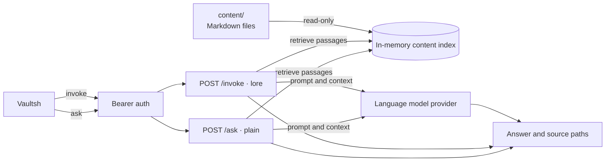

# Oracle Architecture

Oracle is an authenticated, read-only question-answering service for the
Backend Lab portfolio. It grounds answers about Mateo and the project in the
shared Markdown content and a hosted language model. It has no tools, no write
mounts, and never changes the system.

Vaultsh exposes it through two read-only commands: `invoke <question>` answers
in the Oracle's lore voice, and `ask <question>` answers plainly with no system
prompt.

## Components

- **Authentication:** Protects both endpoints with a service bearer token;
  health and status stay public inside the private Compose network.
- **Two modes:** `invoke` sends the lore system prompt; `ask` sends no system
  prompt at all and answers plainly. Both retrieve the same content and return
  the source paths they used.
- **Content index:** Loads the mounted Markdown once at startup and retrieves
  passages that match the question.
- **Provider:** Sends the question and selected passages to a hosted language
  model. OpenRouter, Groq, and `mock` are supported; `mock` is used for local
  testing. On OpenRouter an ordered `ORACLE_MODELS` list rotates through free
  models as they are rate-limited. Groq is the default free option because its
  free tier allows 1000 requests/day.
- **Answer:** Returns short plain text plus the source paths used to ground it.

## Answer Flow

Oracle normalizes the question, selects the most relevant documents (falling
back to `about`, `overview`, `skills`, and `experience`), and prompts the model
with only that context.

In lore mode (`invoke`) the system prompt scopes answers to Mateo and Backend
Lab, refuses unrelated or secret-seeking requests, and requires short plain
text. In plain mode (`ask`) the same user message is sent without a system
prompt, so it carries no persona or refusal rules; it still only receives
retrieved public content.

## Voice

In lore mode Oracle answers as a small homage to the oracle at Delphi,
addressing the seeker in calm, plain pronouncements. The voice is seasoning
rather than a riddle: facts are always stated plainly, and the grounding,
refusal, and secret-safety rules take precedence over tone. It points seekers to
`help`, `/docs/commands.md`, and the `/cv` files, and it may add a little warm,
puckish wit about Mateo, who built the project — never at his expense and never
a quip instead of a fact. Plain mode has no voice at all.

## State and Limits

Oracle is stateless apart from an in-memory answer cache. It bounds cost and
abuse with a per-question length limit, a maximum answer length, a concurrency
semaphore, an identical-question cache, and a daily upstream budget shared by
both modes. When the provider is unavailable or the budget is exhausted, Oracle
returns `503` and Vaultsh prints `invoke unavailable` or `ask unavailable`.

## Failure Behavior

- A provider error or exhausted budget returns `503`; Vaultsh degrades to
  `invoke unavailable` or `ask unavailable`.
- A missing content directory yields an empty index; answers fall back to the
  retrieved content only.
- Oracle never writes to the content mount and holds no durable user data.
- Provider unavailability does not affect any other Vaultsh command.

## Decisions

- Keep the provider credential and SDK out of Vaultsh.
- Give the assistant a short Delphic voice in one system prompt rather than a
  separate persona service or UI.
- Offer a plain mode (`ask`) that omits the system prompt for direct, unvoiced
  answers.
- Ground answers in the same content Vaultsh and Atlas read.
- Answer with short plain text so the terminal needs no second rendering UI.
- Expose the assistant as read-only commands rather than an interactive session
  in the first version.
