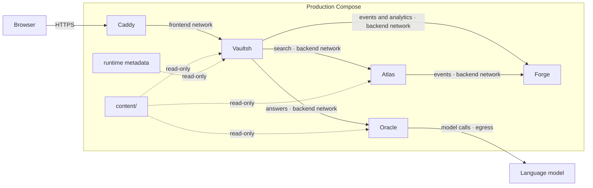

# Backend Lab: system overview

Backend Lab is an integrated backend engineering showcase. A browser terminal and Explorer expose a read-only Markdown filesystem; separate services add search and telemetry, while the Lab repository owns the shared content and deployment.

## Components

- **Vaultsh** serves the terminal, Explorer, virtual shell, sessions, completion, and read-only document browsing. It owns the HTTP entry point and virtual filesystem.
- **Atlas** scans the shared Markdown files for case-insensitive search and returns source paths and line numbers.
- **Forge** accepts bounded telemetry events, stores them in SQLite, and returns summaries and text dashboards.
- **Oracle** answers questions about Mateo and the project, grounded in the shared content and a hosted language model.
- **Sentinel** runs in CI to collect evidence and apply deterministic release policy. It is not a runtime service. Its current analysis provider is a mock; production LLM analysis is planned.
- **Lab** owns Docker Compose, Caddy ingress, shared content, deployment workflows, runtime metadata, and project-specific Sentinel policy.

Internals: [Vaultsh](vaultsh/architecture.md), [Atlas](atlas/architecture.md), [Forge](forge/architecture.md), [Oracle](oracle/architecture.md), and [Sentinel](sentinel/architecture.md).

## Runtime topology

Caddy is the only internet-facing container. Vaultsh joins the frontend and backend networks; Atlas and Forge join only the backend network. Independent bearer tokens protect service APIs. Health and status probes are public only inside the private Compose networks.

## Data and communication

`lab/content/` is the only content source. Vaultsh loads it into an in-memory virtual filesystem; Atlas scans the same files. Neither service writes it. Vaultsh's Explorer reads that filesystem through a read-only browse endpoint; the browser renders document previews without creating a second content copy.

Vaultsh calls Atlas synchronously for search and Forge synchronously for analytics reads. Vaultsh calls Oracle synchronously for answers; Oracle mounts the same content read-only and reaches the language model provider over an egress network. Vaultsh and Atlas send events through bounded in-process queues, so telemetry failure or queue saturation never blocks user requests. There is no message broker.

Deployment and sanitized Sentinel results are CI-produced JSON files mounted into Vaultsh. Forge stores bounded telemetry events in a SQLite database.

## Design decisions

Vaultsh and Atlas read one content mount; neither writes to it. Caddy is the public entry point, with Atlas and Forge on the private backend network. Atlas search and Forge telemetry degrade independently. Lab deploys immutable service images by commit SHA and supports targeted updates and tested rollback.

## Failure boundaries

- Atlas failure disables search only.
- Forge failure disables analytics and loses undelivered telemetry.
- Oracle failure disables the assistant only.
- Vaultsh restart discards sessions.
- Accepted Forge events survive restarts; producer queues can still lose events before delivery.
- Provider or CI failure does not affect the last deployed runtime.

The system deliberately favors graceful degradation and replaceable process-local state over distributed coordination.

## Status and limits

The shell, browse API, line scanning, SQLite telemetry, and CI assessment are implemented. Search has no index or ranking; Forge producers use best-effort queues; Vaultsh sessions are local and expire. The assistant answers from the shared content with a hosted model and is bounded by a daily budget. Sentinel's Lab policy is advisory, and its analysis provider is a mock.

## Repository boundaries

Each application repository owns its source, tests, dependencies, and Dockerfile. Lab owns Compose, Caddy, shared content, environment configuration, release policy, and deployment workflows. Application logs go to container stdout and are distinct from Forge telemetry.

## Explore next

- [Vaultsh](vaultsh/overview.md) · terminal, parser, and virtual filesystem
- [Atlas](atlas/overview.md) · search design
- [Forge](forge/overview.md) · telemetry and dashboard
- [Oracle](oracle/overview.md) · grounded question answering
- [Sentinel](sentinel/overview.md) · CI release assessment
- [Scribe](scribe/roadmap.md) · proposed provider snapshot service
- [Deployment](../deployment.md) · orchestration and rollback

Source: [Lab](https://github.com/mateoRc/lab), [Vaultsh](https://github.com/mateoRc/vaultsh), [Atlas](https://github.com/mateoRc/atlas), [Forge](https://github.com/mateoRc/forge), [Oracle](https://github.com/mateoRc/oracle), and [Sentinel](https://github.com/mateoRc/sentinel).
